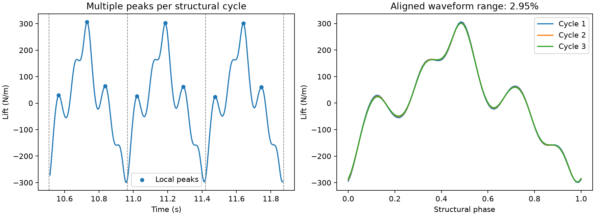

# M6 细网格变形与多峰周期修复

2026-10-14。用户授权定位并修改，单一执行者。旧结果保留；M6尚未完成。

## 1. 实际原因

上一批时间细化完成2400步/12秒，但升力独立寻峰统计未稳定；空间细化接受927步/9.27秒，第928步第二次候选的单元5893面积比0.191107低于0.2。二者均已退出。

### 网格不是单纯的迭代超调

原配置隔离重放逐值复现失败。将初始松弛从0.5降为0.25，仍在第三次候选以0.196391失败。另做明确标为“不合格诊断”的隔离计算：仅在这个进程内暂时降低几何拒绝阈值，以观察固定点；收敛后的面积比仍只有**0.197820194**，全场残差3.48422e-9。由此不能用回退或更多迭代恢复原0.2门槛。

该诊断不是合格解，不保存正式续算断点，不修改正式代码的默认门槛。原配置中的参考域调和权重未能在这种较大变形下充分保护细网格邻近单元。

### 升力一个物理周期包含多个峰

旧时间细化末段梁尖频率2.19921 Hz，但升力相邻局部峰被当作周期，得到约6.60020 Hz以及53.63%的周期变化。按梁尖完整周期对齐，升力幅值变化为1.250%，均值变化0.0449%；然而完整波形变化仍为**2.9548%**，超过2%，所以不能据此直接改判稳定。

## 2. 修改与适用边界

### 显式新网格配置

保持加权调和公式 `w=(length/sqrt(distance²+length²))^power` 和长度0.005 m，将新研究配置的power从1改为1.5。该参数改变ALE网格方程，不改变材料或流体模型；两个耦合求解路径继续复用同一刚度、残差和切线。没有修改原配置或正式质量门槛，也没有临时绕过网格检查。

对927步的实际边界形状及合成放大形状做几何检查：

| 位移倍数 | 原power=1面积比 | 新power=1.5面积比 | 新最小质量 |
| --- | ---: | ---: | ---: |
| 1.00 | 0.234858 | 0.400591 | 0.446912 |
| 1.15 | 0.102782，不合格 | 0.310680 | 0.354249 |
| 1.30 | 单元翻转，不合格 | 0.220769 | 0.257994 |

扫描也包括power=2/3及不同长度，并非权重越大越好；部分更强权重将畸变转移到其他区域。放大形状仅是几何压力样本，不是FSI计算结果。该选择经过局部验证，仍不能保证所有后续形状都合格。

新增[共同基线](../../cases/fsi2_mesh15_baseline.json)、[时间细化](../../cases/fsi2_mesh15_time_half.json)、[空间细化](../../cases/fsi2_mesh15_space_half.json)。三者使用同一网格权重，分别只改dt或h；旧power=1轨迹不能混作新研究的共同基线，正式新运行须从零开始。

### 完整周期与波形检查

[`analyze_fsi2`](../../src/fsi_ice/validation/fsi2.py)先用梁尖峰定义末尾三个完整运动周期，再对梁尖、阻力、升力使用相同边界，计算幅值、时间加权均值和周期变化。独立峰统计保留在`independent_peak_statistics`，供诊断谐波。`statistics`中力的frequency现在表示共同物理周期率，不是力的主谱峰；[分析脚本](../../scripts/fsi2_analyze.py)同步更新表格与CSV说明。

新增`waveform_variation`：各周期映射到0–1相位，在线性插值样本相位的并集上求跨周期最大极差，再除以平均半峰峰幅值。分段线性曲线之差的最大值出现在这些断点，避免任意稀疏相位网格漏掉变化。采用原幅值变化上限2%作为附加条件，原周期、幅值、均值及参考精度条件继续保留；缺少梁尖完整周期时，力的局部峰不能代替它。

这是离散时程的稳定性检查，无法补回时间采样未解析的高频内容，仍需独立时间收敛研究。旧12秒时间细化重新分析仍为INCOMPLETE：梁尖/阻力/升力波形变化分别0.5008%/2.0034%/2.9548%；主频参考偏差约13.95%，暂定统计不能冒充精度通过。

## 3. 本地验证

- 原失败点在新权重下，以13次外层评估通过：面积比0.392147、质量0.462567、全场残差3.15171e-9。
- 时间细化12秒旧状态后的5步隔离压力诊断通过，最大残差3.24087e-8，最小面积比0.729429。只是改变网格方程后的局部压力检查，不是正式12.025秒续算。
- 细网格928–937连续10步隔离诊断全部通过，最大全场残差5.09398e-8、最小面积比0.361924、最小质量0.462567。最终全量回归 **743 passed、2 skipped，226.64 s**；跳过项为可选T23既有产物检查及真实FSI1整体长程烟雾检查。
- 三套新配置均从零运行3步，返回预期的INCOMPLETE/3。新的自动运行与分析入口也通过1步端到端检查，求解目录与分析目录分离，实际生成summary与comparison。
- 针对性109 passed，41.41 s；之后补充“无梁尖周期时力峰不能替代”测试，纳入最终全量回归。
- 解析多峰稳定力波通过；相位漂移、次谐波、均值漂移仍拒绝稳定。新power=1.5通过平移/仿射补丁、一维制造解加密收敛、耦合Jacobian、四算法BDF1/BDF2一致性及回滚/断点检查。[周期测试](../../tests/test_fsi2.py)、[网格与耦合测试](../../tests/test_m6_repair.py)、[真实几何样本来源](../../tests/data/mesh_large_deflection/manifest.json)。

正式断点身份守卫保留。旧源码与旧配置数据只读加载到隔离诊断驱动，不生成伪装为新源码的正式轨迹；改变网格方程后的旧流场/ALE历史仅作为局部压力初始数据，不构成一致的长期积分。当前包源码摘要：`cb58278f3dbde144477824b9e5e0c4db04f0935a8f37d31ffac20b452597cf27`。物理求解源码未改；本轮包内代码修改属于周期分析。部分先行压力进程与分析代码整理并行，归档区分其记录摘要及最终冻结源码检查。

本轮未上传远端。完整新轨迹、参考精度与三档独立收敛需要后续实测，不能用这些局部检查标记M6完成。

[紧凑归档与SHA256清单](artifacts/m6_mesh_cycle_repair/manifest.json)包含原失败复现、明确标注不合格的低门槛诊断、参数扫描、修复后局部验证、真实周期分析、来源守卫与日志。原文件哈希均未变化。

## 4. 完整新研究状态

所有本地验证通过后，已以冻结源码cb58278f…从零启动共同基线、时间减半和网格减半三组12秒实验，目录`results/m6/frequency_accuracy_mesh15/`，每进程BLAS/OMP各1线程。自动运行器保存源码副本、配置哈希、实际退出码，并在结束后对各自trajectory目录做只读分析、生成comparison.json。三组现均已完成12秒：细网格PASS，基线与时间细化周期INCOMPLETE；最终证据见[阶段收尾](m6_stage_close.md)，并发耗时不用于性能排名。与旧基线的网格方程不同，因此新增共同基线是必要对照。

文档检查：HTML标签平衡、16个唯一id、225条href及新增Markdown本地链接通过；响应式CSS静态检查通过，真实升力图已视觉检查。没有可用浏览器，本轮未做宽窄窗口截图。`git diff --check`通过。
